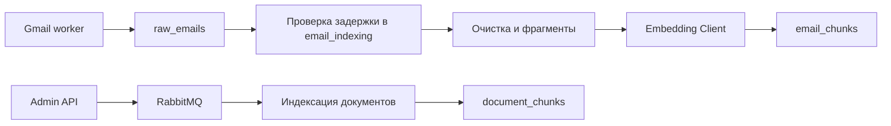
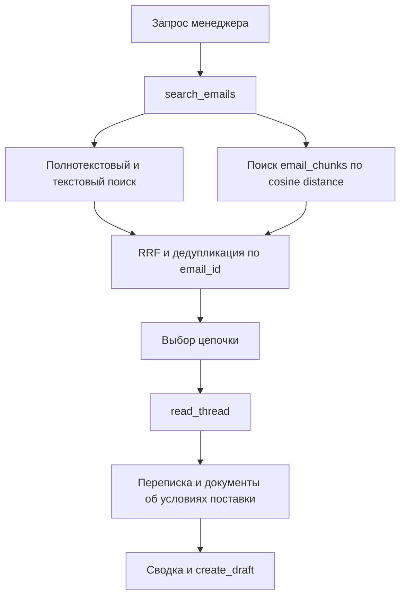

# Архитектура RAG и ограничения системы

## Расположение кода

В `app/services/rag/ingestion/` и `retrieval/` каждый домен хранится
в отдельном пакете `document/` или `email/` со своим `service.py`.
Очистка и подготовка фрагментов писем находятся рядом с email ingestion.
Общий Markdown-алгоритм разбиения текста находится в `ingestion/chunking.py`.
Форматирование документов для контекста находится в `retrieval/document/`,
объединение рангов почтового поиска — в `retrieval/email/ranking.py`.
Общие модели данных определены в `app/dto/rag.py`.

`DocumentIngestionService` индексирует документы, `EmailIngestionService` —
исходные письма. `DocumentRetrievalService` получает условия компании для
ответа, `EmailRetrievalService` объединяет текстовый и семантический поиск
кандидатов для `search_emails`. Цепочки читаются целиком через `ThreadService`;
векторы и LLM-саммари цепочек не создаются.

Воркеры запускаются независимо: `app/workers/email_indexing.py` периодически
выбирает письма, `app/workers/document_indexing.py` обрабатывает очередь
документов RabbitMQ. Каждый воркер собирает собственные DAO и сервисы
и управляет временем жизни своих ресурсов.

## Индексация источников

PostgreSQL хранит исходные письма в `raw_emails`, цепочки в `threads`,
черновики в `drafts`. Модель эмбеддингов создаёт векторы размерности
1024 для очищенных фрагментов писем и документов компании.

Письмо готово к индексации через 30 минут после сохранения или изменения
его содержимого. Задержка задаётся в `RagWorkerConfig` через
`RAG_WORKER_INDEXING_DELAY_MINUTES`. Время последнего изменения и
проиндексированная версия хранятся на письме. Повторный импорт
неизменившегося письма сохраняет эти значения.

Воркер `email_indexing` проверяет PostgreSQL раз в минуту и обрабатывает до десяти
писем за проход. Индексация начинается после первого успешного прохода
Gmail-синхронизации. Одиночные письма и ответы обрабатываются одинаково.

Из письма удаляются цитаты и подписи, сохраняется содержимое пересылки.
Тема добавляется к каждому фрагменту. Размер тела фрагмента — до 1100
символов, перекрытие — 200, префикс темы — до 300. Пустое письмо
отмечается обработанным. Эмбеддинги строятся существующим клиентом.
LLM используется при формировании ответа пользователю.

Фрагменты письма заменяются одной транзакцией после проверки версии
исходного текста и поколения подключения. Ошибка оставляет письмо
для следующего прохода. Рабочее окружение использует один воркер `email_indexing`.
Фрагменты устаревшей версии исключаются из семантического поиска.

## Поиск и ответ

`search_emails` сохраняет контракт результатов с ID письма и цепочки,
темой, отправителем, датой и фрагментом. Векторные кандидаты с cosine
distance менее 0,6 объединяются с лексической выдачей через RRF
с константой 60. При недоступности embedding-сервиса сохраняется
лексическая выдача. Эти стартовые параметры требуют проверки качества
на размеченной выборке.

При выборе последней переписки отбирается до 100 кандидатов из каждой
ветки. После слияния код сравнивает последнюю дату сообщения
соответствующих цепочек, включая сообщения без искомых слов.
При одинаковых датах разных цепочек агент запрашивает уточнение.
Ограничение кандидатов означает, что полнота поиска зависит от отбора.

`read_thread` читает полную актуальную цепочку из PostgreSQL.
Последнее входящее письмо определяет получателя черновика.
Запрос и переписка используются для подбора документов компании.
В основном графе поиск сводок `email_thread_vectors` отключён.
Эта таблица и прежний код суммаризации сохранены для сравнения baseline.

## Доступ и источники

Поиск, чтение и сохранение черновика ограничены владельцем аккаунта.
Для подключения допустимы состояния connected, syncing и sync_error.
Отключённые аккаунты исключаются из результатов. Ограничения
применяются до сортировки и LIMIT. Доступ к документам компании
определяется существующими ролями.

Письма и документы передаются модели как недоверенные данные.
Сохраняются входная фильтрация, маскирование PII и проверка Canary.
Ссылки на письма и документы в результате проверяются по переданному
контексту. Очистка текста сама по себе не устраняет prompt injection.

## Ограничения и проверка

- Полная цепочка передаётся в модель, поэтому большие переписки
  могут превысить контекстное окно. Размер документа в контексте
  ограничен 2500 символами на фрагмент.
- Для черновика предполагается переписка с одним клиентом.
  Отправитель последнего входящего сообщения используется как адресат.
- Gmail-синхронизация по дате отслеживает новые письма. Изменения
  меток и удаления требуют отдельной сверки или истории Gmail.
- Конфигурация полнотекстового индекса — russian. Текстовый поиск
  также проверяет подстроки, а семантический зависит от модели.
- Незавершённые диалоги агента хранятся в памяти процесса API.
- Сквозной интеграционный тест выполняется на отдельной PostgreSQL
  при заданном `EMAIL_RAG_TEST_DB_URL`. Ответы LLM и эмбеддинги
  в этом тесте заданы, чтобы проверить связность пайплайна и доступ.
  Измерение качества реальной модели проводится отдельно.

Порядок экспериментов и внешние benchmark-источники приведены в
[плане реализации](email_rag_implementation_plan.md).
